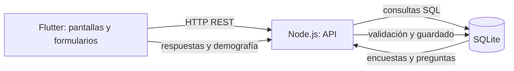
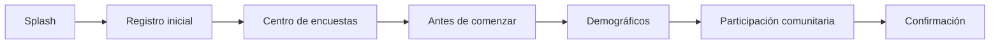
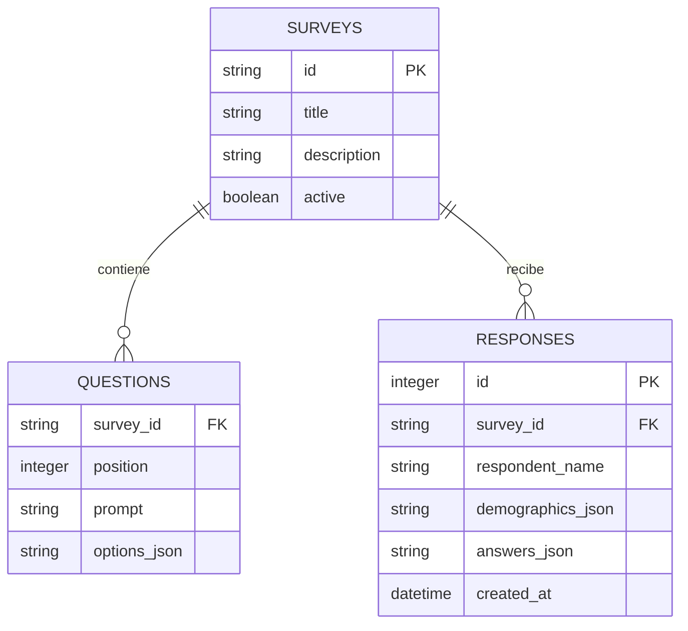

# Documentación del proyecto

## Problema y justificación

**Problema propuesto para validar con el equipo:** reunir información sobre convivencia, seguridad, participación y necesidades comunitarias requiere un mecanismo de captura ordenado y consistente. El prototipo plantea una encuesta móvil que guía a la persona por preguntas demográficas y comunitarias, y registra las respuestas en una base de datos.

La propuesta permite centralizar las respuestas de una encuesta y deja una base para que el equipo pueda revisarlas posteriormente. El proyecto no parte de estadísticas ni de resultados de campo; esos datos deberán agregarse cuando existan fuentes verificables.

## Objetivos

### Objetivo general

Construir un prototipo móvil de encuestas comunitarias que consulte el catálogo de encuestas desde una API y almacene la información capturada en una base SQLite.

### Objetivos específicos

- Presentar el acceso a la encuesta desde una pantalla principal alimentada por el backend.
- Capturar datos demográficos y respuestas a preguntas de participación comunitaria.
- Validar las respuestas y enviarlas mediante una API REST.
- Persistir encuestas, preguntas y respuestas con una estructura relacional.
- Mantener separadas la interfaz Flutter y la lógica de API y persistencia.

## Alcance del prototipo

Incluye una encuesta de participación comunitaria, registro de nombre, formulario demográfico, ocho preguntas de opción múltiple, navegación entre pantallas y envío de la respuesta al backend. Las preguntas y opciones iniciales se cargan en SQLite cuando se crea la base por primera vez.

No incluye inicio de sesión, administración de encuestas, historial consultable, exportación de resultados, sincronización sin conexión, despliegue en la nube ni medidas suficientes para tratar datos personales en producción. La pantalla de historial actual es ilustrativa y todavía no consulta el API.

Antes de una prueba de campo, el equipo debe confirmar la población objetivo, el significado del nombre registrado, el consentimiento informado y el tratamiento de datos. El servicio actual no cifra ni protege las respuestas con autenticación.

## Arquitectura

### Flujo de pantallas

## Modelo de datos

Las tablas `surveys` y `questions` describen el catálogo. Cada fila de `responses` guarda el nombre capturado, los seis campos demográficos y las respuestas ordenadas como JSON. Las opciones se validan en el servidor antes de insertar.

## Contrato del API

| Método | Ruta | Uso |
| --- | --- | --- |
| `GET` | `/health` | Comprueba que el servicio está activo. |
| `GET` | `/api/surveys` | Devuelve encuestas activas y número de preguntas. |
| `GET` | `/api/surveys/:id` | Devuelve el detalle con preguntas y opciones. |
| `POST` | `/api/responses` | Valida y guarda una respuesta completa. |

El `POST /api/responses` recibe `surveyId`, `respondentName`, `demographics` (`surname`, `residents`, `minors`, `adults`, `occupation`, `maritalStatus`) y `answers`, una opción válida por cada pregunta.

## Diseño de pantallas

Las pantallas implementadas en Flutter sirven como diseño funcional del prototipo. La rúbrica solicita además mockups realizados en Figma; esos archivos no forman parte del repositorio todavía y deben adjuntarse como evidencia visual independiente.

## Entorno y seguridad

El backend requiere Node.js 22.13 o posterior por el uso de `node:sqlite`; no necesita paquetes npm externos. La URL del API puede cambiarse con `SURVEY_API_BASE_URL`. El HTTP sin cifrar y CORS abierto se usan únicamente para desarrollo local; para producción se requieren HTTPS, autenticación, autorización, política de conservación y respaldo seguro de los datos.